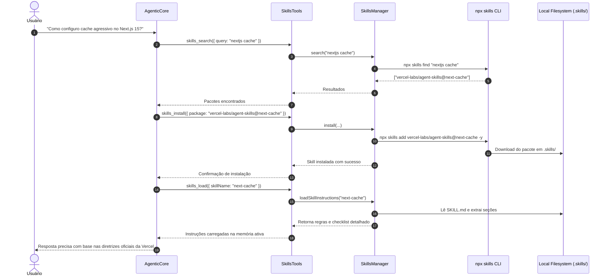

# Integração do AgenticCore com o Ecossistema Open Agent Skills (`npx skills`)

> **Disponível a partir da versão 3.4.0** do `@areumtecnologia/agentic-core`.

---

## 📖 Visão Geral

O ecossistema **Agent Skills** ([skills.sh](https://skills.sh/)) é um padrão aberto para empacotamento, distribuição e execução de instruções especializadas, regras de engenharia e scripts de automação para agentes autônomos de IA.

Através do módulo `skills` e do CLI oficial `npx skills`, o **AgenticCore** ganha a capacidade de se auto-estender em tempo de execução (*Self-Extending Agent*). O agente é capaz de identificar quando não possui domínio sobre um framework ou tarefa específica, pesquisar no repositório público, instalar o pacote de regras e carregá-lo contextualmente na sessão ativa via *lazy loading*.



---

## ⚙️ Configuração no `AgenticCore`

Você pode habilitar o ecossistema de skills passando o objeto `skills` diretamente no construtor do `AgenticCore`:

```javascript
const { AgenticCore, AgentConfig, AgentEvents } = require('@areumtecnologia/agentic-core');

const agent = new AgenticCore({
  apiKey: process.env.GOOGLE_GEMINI_API_KEY,
  agent: new AgentConfig(
    'SoftwareArchitect',
    'Áreum Tecnologia',
    'Empresa de IA e Automação',
    'Especialista em Arquitetura de Software',
    'Construir aplicações resilientes e de alta performance',
    'Consulte suas skills instaladas para seguir os melhores padrões da indústria.',
    'pt-BR'
  ),
  skills: {
    enabled: true,                       // Ativa o gerenciamento nativo de skills
    autoPrompt: true,                    // Injeta sumário no System Prompt (<skills_protocol>)
    allowAutoInstall: true,              // Permite ao agente baixar skills dinamicamente
    allowExecuteScripts: true,           // Permite ao agente executar scripts de skills
    trustedOwners: [                     // Allowlist de segurança para instalação
      'vercel-labs',
      'anthropics',
      'areumtecnologia'
    ],
    skillsDirs: ['./.skills', './skills'], // Diretórios para varredura de skills locais
    primaryInstallDir: './.skills',       // Diretório onde novas skills serão salvas
    scriptTimeoutMs: 30000,              // Timeout para execução de scripts auxiliares
  }
});
```

---

## 🔧 Ferramentas Registradas no Agente

Quando `skills` está habilitado, o agente recebe automaticamente as seguintes ferramentas em seu catálogo:

### 1. `skills_search`
Permite ao agente buscar skills tanto na base local quanto no registro público online.
- **Parâmetros**:
  - `query` (*string*, obrigatório): Termos de busca (ex: `"react performance"`, `"kubernetes deploy"`, `"security"`).
  - `owner` (*string*, opcional): Filtra a busca para um proprietário específico no GitHub (ex: `"vercel-labs"`).

### 2. `skills_install`
Faz o download e a instalação de uma skill a partir do ecossistema aberto via CLI.
- **Parâmetros**:
  - `package` (*string*, obrigatório): Identificador do pacote (ex: `"vercel-labs/agent-skills@react-best-practices"` ou `"owner/repo"`).

### 3. `skills_list`
Lista todas as skills atualmente instaladas e disponíveis no workspace com versão, descrição e scripts disponíveis.
- **Parâmetros**: Nenhum.

### 4. `skills_load`
Carrega o conteúdo do arquivo `SKILL.md` (metadados, workflows, regras de qualidade e scripts disponíveis) diretamente para a memória de trabalho da sessão.
- **Parâmetros**:
  - `skillName` (*string*, obrigatório): Nome exato da skill a ser carregada.

### 5. `skills_execute_script`
Executa um script de suporte contido na pasta `scripts/` da skill (ex: scripts em `.js`, `.py`, `.sh`).
- **Parâmetros**:
  - `skillName` (*string*, obrigatório): Nome da skill detentora do script.
  - `scriptName` (*string*, obrigatório): Nome do arquivo ou identificador do script.
  - `args` (*array de strings*, opcional): Argumentos passados via linha de comando.

### 6. `skills_create` (Novo)
Permite ao agente sintetizar e salvar novas skills locais dinamicamente (*Self-Learning*).
- **Parâmetros**:
  - `name` (*string*, obrigatório): Nome único da skill em kebab-case (ex: `"aws-deploy-checklist"`).
  - `description` (*string*, obrigatório): Resumo conciso de 1 frase.
  - `workflow` (*string*, obrigatório): Instruções passo a passo e diretrizes.
  - `rules` (*array de strings*, opcional): Lista de restrições ou regras obrigatórias.
  - `tags` (*array de strings*, opcional): Tags para busca e descoberta heurística.
  - `scripts` (*objeto*, opcional): Mapa de `filename -> code` para scripts auxiliares na pasta `scripts/`.

### 7. `skills_analytics` (Novo)
Permite inspecionar a telemetria em tempo real, latência de scripts, taxa de sucesso, consumo de tokens e eficiência por skill.
- **Parâmetros**:
  - `skillName` (*string*, opcional): Nome específico para filtrar métricas.
  - `format` (*string*, opcional): `"markdown"` (tabela formatada), `"summary"` (conciso), `"json"`, ou `"object"`.
  - `reset` (*boolean*, opcional): Se deve zerar os contadores de métricas.

---

## 🚀 Evoluções Avançadas

### 1. 🔒 Integridade Criptográfica & Lockfile (`skills-lock.json`)

Para prevenir adulterações maliciosas em ambientes corporativos, o `SkillsManager` suporta verificação de integridade via hash **SHA-256**:
- Toda skill instalada ou criada tem seu hash determinístico calculado e registrado no `skills-lock.json`.
- Com `verifyIntegrity: true`, o `loadSkillInstructions` e o `executeScript` validam o hash em tempo real antes de qualquer execução:

```javascript
const agent = new AgenticCore({
  skills: {
    enabled: true,
    verifyIntegrity: true, // Bloqueia skills cujos arquivos foram modificados externamente
    lockfilePath: './skills-lock.json',
  }
});
```

### 2. ⚡ Auto-Ativação Heurística no Turno 0 (*Pre-Turn Skill Activation*)

Evite o desperdício de rodadas extras do LLM! Com `autoActivate: true` (padrão):
- O `SkillsManager` analisa a mensagem do usuário no **Turno 0**.
- Caso a mensagem corresponda a uma skill (por nome, tags ou intenção), as diretrizes da skill são **pré-injetadas no contexto** antes da primeira geração do modelo.
- O evento `AgentEvents.SKILL_ACTIVATED` é emitido com a flag `{ preActivated: true }`.

### 3. 👥 SubAgentes Especializados Baseados em Skills (`SkillSubAgent`)

Isole o processamento de regras complexas em um subagente dedicado sem poluir a sessão principal:

```javascript
// Instancia um especialista ancorado estritamente nas regras da skill
const reviewer = agent.spawnSkillSubAgent('security-audit', {
  name: 'SecuritySpecialist'
});

// Executa em uma sessão efêmera isolada
const report = await reviewer.execute('Auditar módulo de login e geração de tokens JWT');
console.log(report.output);
```

### 4. 🧬 Aprendizado e Criação Autônoma de Skills (`createSkill`)

O agente pode aprender novos procedimentos consolidados e gravá-los no disco:

```javascript
await agent.skillsManager.createSkill({
  name: 'homologacao-checklist',
  description: 'Procedimento padronizado de validação de PRs para homologação.',
  workflow: '1. Verificar cobertura de testes\n2. Executar migrações em banco de staging\n3. Validar healthcheck',
  rules: ['Proibido merge sem aprovação de 2 revisores'],
  tags: ['homologacao', 'deploy', 'git'],
  scripts: {
    'verify_env.js': 'console.log(JSON.stringify({ status: "ready" }));'
  }
});
```

### 5. 📊 Telemetria de Eficiência de Skills (Skill Impact Analytics)

O módulo `SkillImpactAnalytics` monitora a eficiência operacional de cada skill:
- **Ativações**: discriminação entre ativação heurística (Turno 0), chamadas explícitas via `skills_load` e execuções via `SkillSubAgent`.
- **Scripts Auxiliares**: contagem de execuções, taxa de sucesso (%), latência mínima, máxima e média (`avgDurationMs`).
- **Consumo de Tokens e Turnos**: tokens de prompt, completion e total atribuídos a turnos onde as skills estavam ativas.
- **Score de Eficiência (0-100)**: pontuação calculada dinamicamente combinando taxa de sucesso, latência e estabilidade.

#### Obtenção de Relatórios

```javascript
// Via API direta do AgenticCore
const reportMarkdown = agent.getSkillAnalytics({ format: 'markdown' });
console.log(reportMarkdown);

// Ou via objeto estruturado para dashboards
const reportData = agent.getSkillAnalytics({ format: 'object' });
```

Exemplo de matriz de eficiência gerada:

| Skill Name | Activations (Auto / Load / SubAgent) | Scripts Executed (Success %) | Avg Latency | Tokens | Efficiency Score |
| :--- | :---: | :---: | :---: | :---: | :---: |
| `docker-optimizer` | 4 (2 / 1 / 1) | 3 (100%) | 42.5 ms | 1,200 | 🟢 100/100 |
| `security-audit` | 6 (4 / 1 / 1) | 5 (100%) | 18.2 ms | 2,450 | 🟢 98/100 |

---

## 📁 Especificação do `SKILL.md`

Uma skill é um diretório contendo obrigatoriamente um arquivo `SKILL.md` e, opcionalmente, subpastas de suporte:

```
minha-skill/
├── SKILL.md                 # Arquivo principal com frontmatter e instruções
├── scripts/                 # Scripts executáveis (.js, .py, .sh)
│   └── validate_schema.js
├── references/              # Documentações de referência e cheatsheets
│   └── api_spec.md
└── examples/                # Exemplos práticos de código
    └── sample_config.json
```

### Exemplo de `SKILL.md`

```markdown
---
name: react-modern-patterns
description: Guia avançado de padrões e hooks modernos para React 19.
version: 1.2.0
author: areumtecnologia
tags: [react, frontend, hooks, clean-code]
---

# React Modern Patterns

Diretrizes arquiteturais para componentes modernos.

## When to Use This Skill
Use esta skill sempre que o usuário solicitar criação, refatoração ou auditoria de componentes React.

## Workflow
1. Verifique a necessidade de estado local vs. gerenciamento global.
2. Utilize Server Components sempre que possível.
3. Execute o script de validação de imports antes de concluir.

## Rules
- Nunca use `useEffect` para sincronização que pode ser computada no render.
- Evite prop drilling acima de 3 níveis de profundidade.
```

---

## 🎯 Eventos no `AgentEvents`

O ciclo de vida das skills emite eventos em tempo real no `AgenticCore`:

```javascript
const { AgentEvents } = require('@areumtecnologia/agentic-core');

agent
  // Emitido quando uma busca por skills é realizada
  .on(AgentEvents.SKILL_SEARCHED, ({ query, items }) => {
    console.log(`[Skills] Busca por "${query}" retornou ${items.length} itens.`);
  })

  // Emitido quando uma nova skill é instalada com sucesso
  .on(AgentEvents.SKILL_INSTALLED, ({ package, skillName, status }) => {
    console.log(`[Skills] Pacote ${package} (${status}): ${skillName}`);
  })

  // Emitido quando o agente carrega as instruções de uma skill na sessão
  .on(AgentEvents.SKILL_ACTIVATED, ({ skillName }) => {
    console.log(`[Skills] Diretrizes ativadas na sessão: ${skillName}`);
  })

  // Emitido na execução de scripts de automação
  .on(AgentEvents.SKILL_EXECUTION, ({ skillName, scriptName, durationMs, success }) => {
    console.log(`[Skills] Execução: ${skillName} -> ${scriptName} (${durationMs}ms, success: ${success})`);
  })

  // Emitido sempre que métricas de telemetria de skills são gravadas
  .on(AgentEvents.SKILL_TELEMETRY, ({ eventType, skillName, record }) => {
    console.log(`[Telemetry] Skill "${skillName}" event: ${eventType}`);
  });
```

---

## 🛡️ Segurança e Governança

1. **Allowlist de Proprietários (`trustedOwners`)**:
   - Se configurado, qualquer tentativa do agente ou de terceiros de instalar pacotes de autores desconhecidos é interceptada e bloqueada antes de qualquer chamada externa.
2. **Execução Não-Interativa (`CI=true` e `-y`)**:
   - Todos os comandos do CLI são executados com flags que suprimem prompts interativos que poderiam travar o processo.
3. **Timeouts Rígidos**:
   - Tanto o CLI quanto scripts auxiliares possuem timeouts configuráveis (`scriptTimeoutMs`, padrão 30s) com sinalização de encerramento (`SIGTERM`).
4. **Isolamento de Ambiente**:
   - Scripts executados recebem uma variável de ambiente `SKILL_DIR` apontando para o diretório raiz da skill correspondente.
